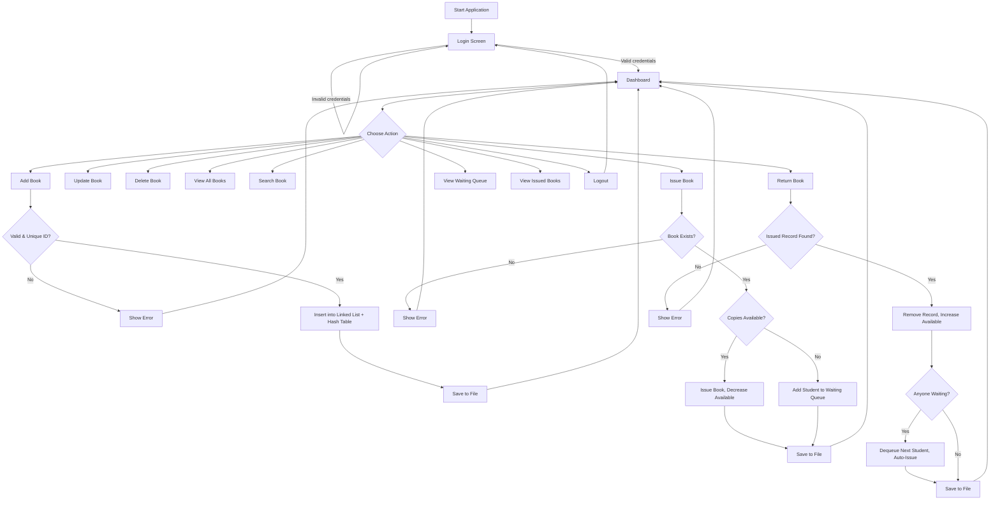
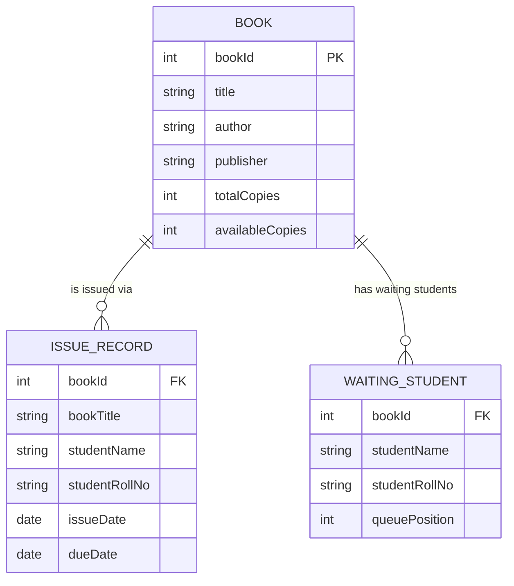

# Flowchart & Entity Relationship Diagram

## 1. Overall Application Flowchart

## 2. Entity Relationship (Data Model) Diagram

> Note: This project uses **file-based serialized storage, not a
> relational database** — there are no SQL tables or foreign keys. The
> diagram below shows the logical relationships between the data entities
> for documentation purposes.

- **BOOK (1) → ISSUE_RECORD (many):** one book can have many historical
  issue transactions over time (though only "currently issued" ones are
  kept in this simple version).
- **BOOK (1) → WAITING_STUDENT (many):** one book can have many students
  waiting for it, held in strict FIFO order by the Queue.
